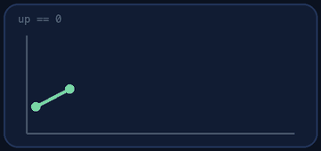
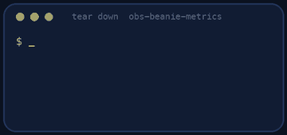

<p align="center"></p>

| | |
|-|-|
| **Time** | 105-120 min |
| **Cost** | free on your own machine (Docker with about 4 GB of memory) |
| **You need** | Docker with Compose v2, git, curl, Python 3 and a terminal |

## How this lab works

1. **Fork** this repository to your own GitHub account (button at the top right).
2. Clone **your fork** in your Ubuntu environment (WSL on Windows, your OrbStack machine on Mac).
3. Read the lab below (the same text is in [`LAB.md`](LAB.md)) and follow the mission.
4. Answer the questions in [`SUBMISSION.md`](SUBMISSION.md). Where a question asks for output, paste it in a code block. No screenshots needed.
5. Commit and push. Open the **Actions** tab of your fork (click *I understand my workflows, go ahead and enable them* the first time). The **Lab check** shows what is still missing.
6. When the check is green, **submit the URL of your fork** in the course platform.

> [!NOTE]
> The check only looks at your answers and any files the lab asks you to commit. Your instructor reads your work and may ask you to explain any line.

<p align="center"></p>

## 🎬 The situation

<p align="center"></p>

Beanie runs as five containers on one host, and the only monitoring is a colleague who refreshes the page now and then. Last night the host ran out of memory, the kernel killed a container, and nobody knew until the morning shift complained. The postmortem has a hard question: *what did we know, and when?* The honest answer is nothing, because nothing was measuring.

There are three layers to measure, and they answer different questions. **The machine** (is the host healthy? CPU, memory, disk) is what **node-exporter** reports. **The containers** (who is using the memory?) is **cAdvisor**. **The application** (are customers being served? how fast?) is what Beanie itself exposes at `/metrics`. You will collect all three in **Prometheus**, show them in **Grafana** on a dashboard that is *code*, write the rules that notice trouble, and then cause the trouble yourself.

> [!IMPORTANT]
> **Your mission**
> - Start Beanie and look at the raw `/metrics` it exposes
> - Add Prometheus, node-exporter, cAdvisor and Grafana to Docker Compose
> - Scrape all three layers and answer questions with PromQL
> - Provision the data source and a dashboard from files
> - Write a recording rule and two alerts, then stop a service and break another
> - Tear it all down and prove it

**Time:** 105-120 min | **Cost:** free on your own machine | **You need:** Docker with Compose v2 (about 4 GB of memory for it), git, curl, Python 3 and a terminal.

<p align="center"></p>

## Part 0 - Beanie, and what it says about itself

Fork this repository, clone your fork and run:

```bash
./setup.sh
docker compose -f compose.beanie.yaml up -d
curl -s localhost:8000/api/menu
curl -s localhost:8000/metrics | grep -E '^beanie_http_requests_total' | head -5
```

`compose.beanie.yaml` is provided complete: five containers from one image, a small traffic generator, and the failure injection switched on. Read it. Look at the metric names and their **labels** (`service`, `route`, `status`). A time series is a metric name plus a unique combination of label values.

> [!NOTE]
> **Think** `beanie_http_requests_total` only ever goes up, and it resets when a container restarts. Why is the raw number almost useless for a dashboard, and what do you need to do to it?

<p align="center"></p>

## Part 1 - The monitoring stack

Write `compose.monitoring.yaml` (the comments say exactly what). Start both files together:

```bash
docker compose -f compose.beanie.yaml -f compose.monitoring.yaml up -d
docker compose -f compose.beanie.yaml -f compose.monitoring.yaml ps
```

Two of the services need to look at the **host** rather than at their own container: node-exporter reads the host's `/proc` and `/sys` (hence `pid: host` and the read-only mount of `/`), and cAdvisor reads the container runtime's files. That is the price of seeing the machine, and it is why such agents are a security decision.

> [!NOTE]
> **Predict** On Docker Desktop for Mac or Windows the "host" that node-exporter sees is a small Linux virtual machine, not your laptop. What does that do to the numbers? Which of the three layers is not affected?

<p align="center"></p>

## Part 2 - Prometheus: scrape the three layers

Write `prometheus/prometheus.yml` (see its comments): four jobs, `beanie` with `honor_labels: true`. Reload it without restarting (`curl -X POST localhost:9090/-/reload`) and open http://localhost:9090/targets.

Then answer these with PromQL in the Prometheus UI. Keep the queries for your submission:

1. The five services' **request rate** per service.
2. The **share of 5xx** in the gateway's requests over 5 minutes.
3. The 95th percentile **latency** of each service (`histogram_quantile` over the `_bucket` series, summed `by (le, service)`).
4. The **host CPU busy percentage**. There is no "busy" counter: only seconds spent in each mode. Derive it from the `idle` mode.
5. The **container using the most memory** (`topk(1, container_memory_working_set_bytes{name!=""})`).

> [!NOTE]
> **Think** Query 4 uses `rate()` on a counter of CPU seconds and then subtracts from 100. Why does `rate(node_cpu_seconds_total{mode="idle"}[5m])` give a number between 0 and the number of cores, and not a percentage?

<p align="center"></p>

## Part 3 - Grafana, as files

Grafana's data sources and dashboards can be created by clicking, and then they live only in a volume. Run `docker compose down -v` and they are gone. Instead, **provision** them: write `grafana/provisioning/datasources/prometheus.yml` and `grafana/provisioning/dashboards/beanie.yml` (see the comments), restart Grafana, log in at http://localhost:3000 as `admin` / `beanie-lab`, and check that the data source exists and is **read-only**.

Build a dashboard with at least five panels (rate, 5xx ratio, p95 latency, host CPU busy, memory per container) in the UI, then **export it as JSON** to `grafana/dashboards/beanie.json` and restart Grafana: it must appear by itself.

<p align="center"></p>

## Part 4 - Rules that notice

Write `prometheus/rules.yml`:

- a **recording rule** `beanie:gateway_error_ratio:rate5m`;
- the alert `BeanieTargetDown` (`up{job="beanie"} == 0` for 30 seconds), a cause-based alert;
- the alert `BeanieHighErrorRate` (the recorded ratio above 5% for one minute), a symptom-based alert.

Reload Prometheus and look at **Alerts**. Both should be `inactive`.

<p align="center"></p>

## Part 5 - Break it

1. `docker compose -f compose.beanie.yaml -f compose.monitoring.yaml stop menu`. Watch the target turn red, then the alert go `pending` and `firing`. Time it. Start menu again.
2. Make menu fail instead of vanish:

```bash
docker compose -f compose.beanie.yaml exec menu python -c \
  "import urllib.request as u;u.urlopen(u.Request('http://127.0.0.1:8001/chaos',b'{\"error_rate\":0.9}',{'Content-Type':'application/json'},method='PUT')).read()"
```

Watch the 5xx panel and the second alert. Set the error rate back to 0.

> [!NOTE]
> **Think** In step 1 the cause alert fired first; in step 2 only the symptom alert could. Which failure did the cause-based alert never see? Which of the two would you let wake someone at 3 a.m.?

<p align="center"></p>

## Part 6 - Prove it

<p align="center"></p>

```bash
./verify.sh
```

It reads Prometheus and Grafana through their APIs, checks that the data source and dashboard were **provisioned**, then stops `menu` and makes it fail, and waits for the alerts. It takes about 8 minutes. Fix what is red and run it again until it ends with **ALL CHECKS PASSED**.

> [!TIP]
> **Stuck?** A target is `down`: wrong host name or port in `prometheus.yml` (inside Compose the host name is the service name). No `service` label: `honor_labels`. cAdvisor shows no containers: its mounts. Grafana shows "No data": the data source URL must be `http://prometheus:9090` (the container name, not `localhost`). The dashboard does not appear: the provider path must match where you mounted the JSON. Reload with `curl -X POST localhost:9090/-/reload`.

<p align="center"></p>

## Level up (optional)

- Add `alertmanager` to the stack and send `severity: critical` alerts to a webhook receiver of your choice.
- Add `blackbox-exporter` and probe `http://gateway:8000/readyz` from the outside. What does it see that the app's own metrics cannot?
- Use `docker compose stats` next to cAdvisor's numbers. Where do they differ and why?
- Write the SLO of the Kubernetes lab (burn rate, two windows) for this stack.

<!-- teardown:start (generated by labs.py, do not edit) -->
## Tear down (mandatory)

<p align="center"></p>

Resources left behind cost money, keep doors open and pollute the next lab. Removing what you created is part of the job, so it is part of the submission: **you must prove it is gone**.

Do this **last**, after you have pasted your `verify` output into `SUBMISSION.md` (once you tear down, the lab can no longer be verified).

1. Run `./teardown.sh`. It stops and removes the containers, networks and volumes of the lab, the locally built image and the cloned Beanie source.

Then run the proof:

```bash
./verify-teardown.sh
```

It prints a list of checks and must end with **TEARDOWN VERIFIED**. If it reports leftovers, remove them and run it again. Paste the full output in your submission.
<!-- teardown:end -->

<!-- submission:start (generated by labs.py, do not edit) -->
## 📬 Submission

Answer the questions in `SUBMISSION.md` in **your fork** (paste output in code blocks where asked), push, then submit the **URL of your fork**.

**Files to commit**

- `compose.monitoring.yaml`: Prometheus, node-exporter, cAdvisor and Grafana
- `prometheus/prometheus.yml` and `prometheus/rules.yml`
- `grafana/provisioning/` and `grafana/dashboards/beanie.json`

**Questions to answer**

1. Paste the Prometheus targets (or `up`) with every target up. For each exporter, say in one sentence what it measures: the machine (node-exporter), the containers (cAdvisor), the application (Beanie itself).
2. Paste a PromQL query for the container using the most memory, one for the host CPU busy percentage (from the `idle` counter) and one for the gateway request rate. Why do you almost always wrap a counter in `rate()`?
3. Paste your two rules and say which of them is cause-based (a service is down) and which is symptom-based (customers get errors). Which would you page on?
4. You stopped `menu`. Paste how long it took for `up` to turn 0 and for the alert to fire, and from what two settings (scrape interval, `for`) that delay comes.
5. Why is your Grafana dashboard and data source provisioned from files instead of clicked together? What happens to a clicked-together dashboard when you run `docker compose down -v`?
6. cAdvisor and node-exporter need access to the host (mounts, `pid: host`). Why is that a security trade-off, and why does it behave differently on Docker Desktop for Mac or Windows?
7. Paste the output of `./verify.sh`. It must end with **ALL CHECKS PASSED**.
8. **Tear down.** Paste the output of `./verify-teardown.sh`. It must end with **TEARDOWN VERIFIED**.
<!-- submission:end -->
